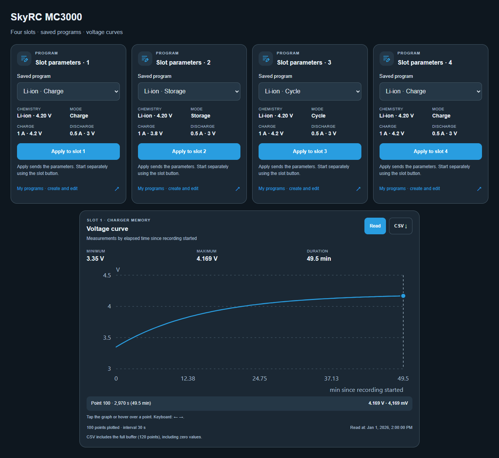
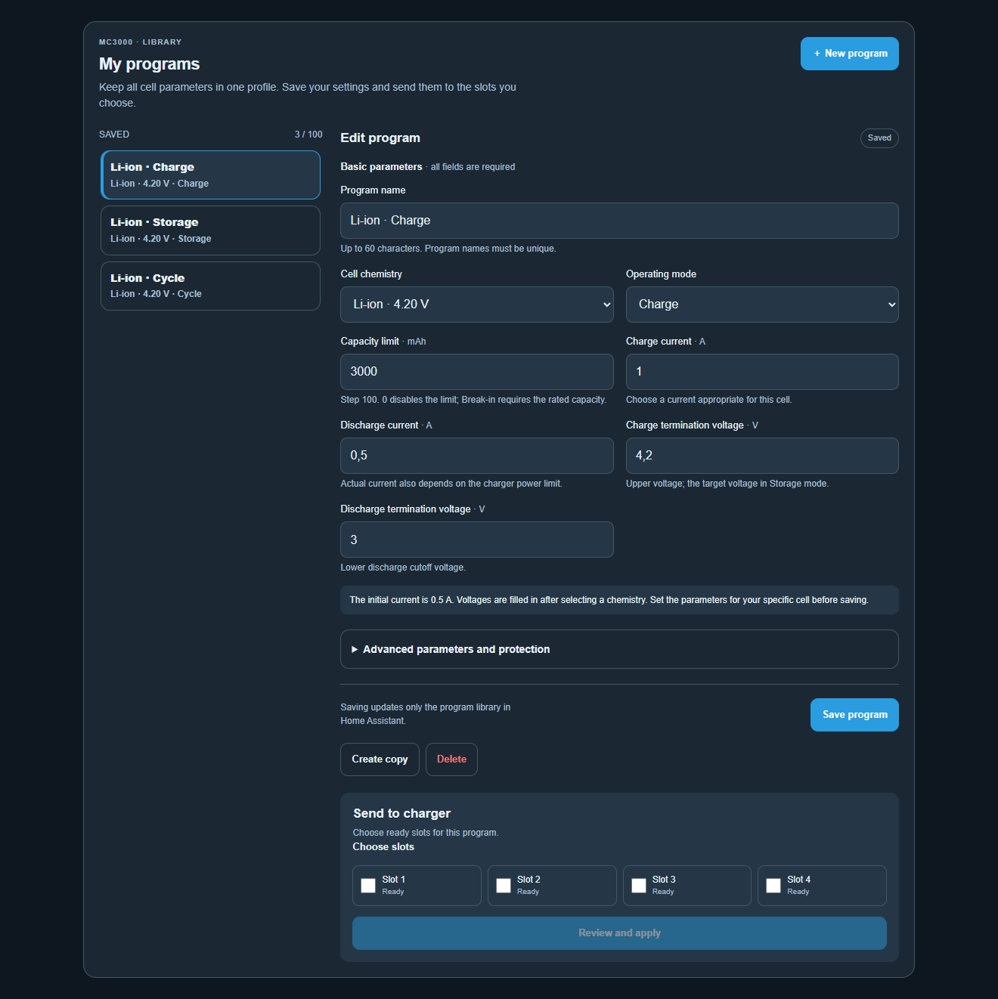

# SkyRC MC3000 for Home Assistant

**Four slots. Saved programs. Local Bluetooth control.**

[](hacs.json)
[](https://github.com/Sergey7up/ha-skyrc-mc3000/releases)

Monitor each battery, build a named program library, send settings to individual
slots and inspect the charger's recorded voltage curves from Home Assistant.
Connect through a local Bluetooth adapter or an **ESPHome Bluetooth proxy**;
no dedicated MC3000 firmware, cloud account or phone app is required.

[Install](#installation) · [Set up the dashboard](#dashboard) ·
[Manage programs](#saved-programs) · [Check validation](#validation-and-limitations) ·
[Read the protocol audit](docs/PROTOCOL.md)

> **Prerelease:** `1.2.0b1` extends upstream v1.1.0. Core controls have been checked
> on a physical charger; full capacity and 24-hour battery workflows remain
> experimental and have automated coverage only. See the validation details below.



*Actual custom cards rendered with illustrative data in an isolated preview.
The sample profiles and curve are demonstrations, not recommended cell settings.*

## What you get

| Feature | Included |
| --- | --- |
| **Four-slot monitoring** | Status, chemistry, mode, voltage, current, capacity, temperature, resistance, elapsed time and power |
| **Saved programs** | Named profiles, all 18 program parameters, chemistry-aware validation and upload to one or more idle slots |
| **Charger control** | Per-slot and group start/stop, expected-chemistry checks and a switch for handing Bluetooth to the phone app |
| **Voltage curves** | The charger's native 120-sample buffer, elapsed-time plot, point inspection and CSV export |
| **Device settings** | Temperature units, display timeout, fan, sound, screensaver and input-voltage cutoff, with readback |
| **Optional battery tools** | Cell inventory, slot assignments, resistance/capacity/quality workflows and exportable reports |
| **Dashboard cards** | Responsive program editor, battery manager and curve viewer; English and Ukrainian, following the HA language |

## Installation

Requires **Home Assistant 2026.1 or newer**, a SkyRC MC3000 and Bluetooth coverage
from HA's adapter or an ESPHome proxy. One charger is supported per HA instance.

### HACS / Marketplace

1. On **Home Assistant 2026.11+**, open **Settings → Marketplace**; on older
   installations, open **HACS**. Add a custom repository of type **Integration**:
   `https://github.com/Sergey7up/ha-skyrc-mc3000`.
2. Open **SkyRC MC3000** and download the desired version. This fork's preview
   is `v1.2.0b1`; check its [release notes](https://github.com/Sergey7up/ha-skyrc-mc3000/releases)
   and enable prerelease versions if your store hides them.
3. Restart Home Assistant. Under **Settings → Devices & services → Add integration**,
   choose **SkyRC MC3000**, then select the charger or enter its Bluetooth address.
4. Optionally install the [dashboard cards](#dashboard); they are separate files.

This fork is the distribution source for the preview. If installing another fork
or an upstream release, use that repository's URL and its matching release files.
Only one repository should manage `custom_components/skyrc_mc3000`. When switching
update sources, preserve your existing integration entry and entity registry.

### Manual installation

Download the source archive for your chosen version. Copy
`custom_components/skyrc_mc3000` into your HA configuration directory, restart HA
and add the integration as above. Upgrade an existing installation in place.

The Python dependency is pinned to `skyrc-ble` v3.0.0. A local protocol adapter
extends packet handling while retaining its Bleak/HA proxy transport. A second
charger entry is blocked so commands cannot be routed to the wrong device.

### Bluetooth and phone access

Add an ESPHome Bluetooth proxy to HA through the normal ESPHome integration and
place it within reliable Bluetooth range. The MC3000 commonly advertises as
`Charger`, `SimpleBLEPeripheral`, or `HitecCharger` with service UUID
`0000ffe0-0000-1000-8000-00805f9b34fb`. Other products share this UUID, so verify
the selected device's address.

The charger accepts one BLE client. **Companion app mode** pauses HA polling and
releases BLE for the SkyRC app; switch it off to return control to HA. It does
not stop an ordinary charger program. An integration-managed battery test is
paused and its stop is verified before releasing Bluetooth.

## Dashboard

Copy `www/mc3000-*-card.js` to `/config/www/mc3000/` and register these JavaScript
modules under **Settings → Dashboards → Resources**:

```text
/local/mc3000/mc3000-programs-card.js?v=1
/local/mc3000/mc3000-batteries-card.js?v=1
/local/mc3000/mc3000-curve-card.js?v=1
```

Increment the URL version on update and reload the browser. Modules are
self-contained, without CDN imports. Backend installation alone does not copy
or register the frontend resources.

Start with the [advanced dashboard example](examples/skyrc-mc3000-advanced-dashboard.yaml):
four slot columns, program editor, settings, optional battery tools and a curve
subview for each slot. Create dashboard URL path `dashboard-mc3000` or adjust its navigation.
Check your actual entity IDs before using the example.

```yaml
type: custom:mc3000-programs-card
mode: editor
# language: en  # Optional en/uk override; otherwise follows HA, falling back to English.
```

For a compact selector, replace `mode: editor` with `slot: 1`. Programs and
batteries accept `entity`, `companion_entity` and a four-element `status_entities`
array for renamed entities. Programs also accept `editor_path`. Curves accept
`slot`, `entity`, `fetch_entity` and `companion_entity`. Default IDs use the
standard `skyrc_mc3000` prefix.

The advanced example uses native HA cards and these three modules, with no other
custom-card dependencies. The [original chart example](examples/skyrc-mc3000-dashboard.yaml)
remains available and requires ApexCharts Card.

## Monitoring and controls

Each slot exposes status, chemistry, mode, voltage, current, capacity,
temperature, internal resistance, elapsed time, power, a cycle counter and LED
state. Connection diagnostics include the last successful update, stale-data
flag and firmware/hardware versions. The device's unavailable resistance markers
are exposed as unknown, not as a zero-ohm reading. Unknown firmware enum values
retain their numeric codes for diagnostics and block unsafe control.

Separate charge/discharge capacity sensors retain the latest observed value of
each phase through subsequent phases and HA restarts. They are observations,
not a sum of cycles or a guaranteed final capacity measurement; attributes mark
continuity gaps and resets.

`input_voltage` is the **input-voltage cutoff setting**, not measured adapter
voltage. Temperature telemetry is normalized to °C even when the charger displays °F.

Buttons provide refresh, per-slot/all-slot start and stop, and curve retrieval.
Start checks **Expected chemistry**, resolved through the entity registry so
renaming a select cannot bypass it. Missing/unavailable policies block control;
select `any` explicitly to opt out. This checks the configured program, not the
physical cell chemistry.

Physical commands are serialized. Group start preflights every slot; failure
attempts to stop the started group. Group stop sends and verifies individual
slot commands. BLE loss cannot guarantee physical stop: the charger may continue
its own program until communication returns.

## Saved programs

The **MC3000 Programs** card edits all program fields: chemistry/mode, charge and
discharge currents/voltages, capacity limit, termination currents, temperature
and time protection, cycle order/count, rest periods, delta peak, trickle and
restart voltage. Programs are stored in HA and survive restart.

**Save**, **select**, **apply**, and **start** are separate operations. Apply
uploads a complete program to selected idle slots and never starts it. After
start, chemistry, mode and status are checked against an upload receipt when
that receipt remains valid for the current connection.

Validation covers Li-ion, LiFePO₄, 4.35 V Li-ion, NiMH, NiCd, Eneloop, NiZn, RAM,
LTO and Na-ion, with chemistry-specific modes and break-in currents derived from
nominal capacity. A valid packet does not establish support on every firmware.

Android named profiles are stored on the phone. This integration does not read
that database or enumerate the charger's 30 internal program memories. Enter
profiles in HA; a physical-cell catalogue record is not required.

<details>
<summary>Preview the program editor</summary>



*Illustrative data. Saving changes the HA library; applying sends parameters;
starting a slot is a separate action.*

</details>

### Actions

| `skyrc_mc3000` action | Purpose |
| --- | --- |
| `save_profile`, `delete_profile` | Persistent named programs |
| `select_profile` | Remember a profile for one slot |
| `apply_profile` | Upload to `slot` or `slots`; optional `validate_only` |
| `write_program` | Upload one complete program directly |
| `start_slot`, `stop_slot` | Control one slot numbered 1–4 |
| `start_all`, `stop_all`, `refresh` | Device controls |

See the HA action selector for every field. `save_profile` and `apply_profile`
support response data. API units: main currents **A**, voltages **mV**,
termination/trickle currents **mA**, rest/protection times **minutes**. The card
displays voltages in V and converts them for the API.

<details>
<summary>Complete program-upload example</summary>

Adjust every limit for the actual cell. Uploading does not start the slot.

```yaml
action: skyrc_mc3000.write_program
data:
  slot: 1
  battery_type: liion
  operation: charge
  capacity: 3600
  charge_current: 1.5
  discharge_current: 0.5
  charge_voltage: 4200
  discharge_voltage: 3000
  charge_end_current: 100
  discharge_end_current: 500
  cycle_time: 0
  cycle_count: 1
  cycle_type: 0
  delta_v: 0
  trickle_current: 0
  maintenance_voltage: 0
  protection_temperature: 45
  protection_time: 240
  discharge_time: 0
```

</details>

## Device settings and curves

Configuration entities edit temperature units, display timeout, fan mode, beep,
screensaver and input-voltage cutoff. A change reads all settings, modifies one,
sends the full packet and checks all fields by reading them back. All slots must
be idle and unreserved by a battery test.

The `0x56` curve response has **245 bytes**: three-byte header, two-byte big-endian
interval and 120 big-endian millivolt samples, without a trailing checksum.
Notification fragments are assembled and matched to the requested opcode/slot.

Curve sensors expose `samples_mv`, `samples_v`, `interval_seconds`, plot bounds
and retrieval time. The curve card plots actual elapsed time, supports keyboard
and touch inspection, and exports the whole buffer as CSV. Empty tail samples
are not shown as a voltage drop. Inactive slots may return zeros; a new program
may clear an earlier curve. Automatic curve fetching remains optional and also
captures a final buffer after an observed program completion or stop.

Use **Download diagnostics** on the integration/device page for a bounded
snapshot of decoded telemetry and recent received protocol frames. It does not
send additional BLE commands. Addresses, profile names and battery notes are
excluded; firmware/hardware versions and raw unknown codes remain available.

## Optional battery workflows

The **MC3000 Batteries** card adds a separate inventory and test interface. Its
catalogue starts empty. Records describe physical cells, rated capacity and
allowed electrical limits, with slot assignment, search, favourites and notes.

- **Internal resistance:** short controlled discharge up to 0.5 A, then stop.
- **Capacity:** charge, rest, measured discharge and storage where supported.
- **Quality:** charge/rest/discharge/recharge/resistance/storage and optional
  voltage-drift observation after 24 hours.

Tests require explicit start. Active and paused jobs reserve their slots. Manual
stop cancels a job only after physical stop is confirmed. After restart,
interrupted tests require explicit resume. Crash recovery attempts one stop
after fresh communication; unconfirmed stop keeps the slot reserved for retry.
Resuming an interrupted capacity discharge repeats charge/rest so a partial
discharge cannot be reported as full capacity.

Reports export JSON, CSV, Markdown and SVG. The last 30 reports retain up to 4096
samples each; very long tests can lose early chart samples. Capacity ratio uses
entered rated capacity, resistance is the charger's own reading under load,
and voltage drift is not a measured loss of capacity.

Actions: `save_cell`, `delete_cell`, `assign_cell`, `start_quality_test`,
`pause_quality_test`, `resume_quality_test`, `cancel_quality_test`,
`export_quality_report`.

## Validation and limitations

Real-device checks used **firmware 1.18 / hardware 2.2** and four 4.20 V Li-ion
cells: dashboard uploads, per-slot/grouped charge and discharge, verified stop,
a short automatic resistance test, 120-sample curves, setting write/readback,
phone handoff/reconnection and profile persistence after HA restarts. Charged
cells taper below the selected current limit.

Full capacity/24-hour workflows and other chemistries have automated coverage
but **have not been physically validated**. Na-ion on older firmware is
unconfirmed. Long workflows are experimental. No automatic thermal/reduced-current
retry, calibration reset or factory reset is provided.

Discharge is limited to 2 A per slot and 15 W total; the manufacturer's four-slot
lithium limit is 1 A per slot. Managed tests use conservative limits, including
at most 1.5 A charge. Manual programs remain subject to the charger's power
limits. HA cannot reliably identify a physically swapped cell.

## Development

Tests use isolated HA/GATT fakes and never contact a charger or HA server:

```sh
python -m venv .venv
# Activate .venv using your platform's usual command.
python -m pip install -r requirements-test.txt
python -m pytest
```

CI runs Python 3.12–3.14. Frontend tests:

```sh
npm ci
npx playwright install chromium
npm test
```

Set `PLAYWRIGHT_CHROMIUM_EXECUTABLE_PATH` to use an existing Chromium instead.
UI tests cover both languages, preserved drafts, validation, confirmation, busy
states, stop recovery, renamed entities and CSV output.

Protocol facts were cross-checked against the official SkyRC Android 4.1.2 app,
the [manual](https://www.skyrc.com/download/MC3000_Instruction_Manual_V1.17.pdf),
[ESP32 project](https://github.com/studiotijn/SkyRC-MC3000-HA-github),
[Rust notes](https://github.com/nietonchique/mc3000-mcp/blob/main/docs/reverse-notes.md)
and [Web Bluetooth project](https://github.com/x3muha/mc3000-control/blob/main/docs/BLE_PROTOCOL.md).
No APK or decompiled application source is distributed here. See
[the command and capability audit](docs/PROTOCOL.md) for byte-level coverage,
unconfirmed fields and the distinction between BLE features and ESP32 workflows.

## Credits

Based on [jperquin/ha-skyrc-mc3000](https://github.com/jperquin/ha-skyrc-mc3000)
and [jperquin/skyrc-ble](https://github.com/jperquin/skyrc-ble). The protocol work
also benefits from the independent implementations linked above. This is a
community integration, not an official SkyRC product.
